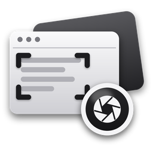

<p align="center"></p>

<h1 align="center">DeskShot</h1>

<p align="center">Free, offline screenshots for Windows and macOS.<br>No account, no uploads, no tracking: your captures never leave your computer.</p>

> **Status: in development.** No release yet. The first version (0.1.0) is being built.

## What it does

| | |
|---|---|
| **Capture** | An area (drag), a window (click it) or the whole screen. Everything on screen freezes the moment you press the key, so open menus and hover pop-ups are caught too. A magnifier and size readout help you pick the exact pixels; a 3, 5 or 10 second delay is there for menus that close on a click. |
| **Start a capture** | **Ctrl+Shift+2** anywhere (Cmd+Shift+2 on a Mac), the tray / menu-bar icon, or (Windows, optional) the **Print Screen** key. |
| **After a capture** | Copy to the clipboard, save to Pictures › DeskShot (PNG or JPG), and keep it in History. |
| **History** | Every capture, newest first, ready to copy, save again or delete. |

Coming in 0.1.0: markup editor (arrows, boxes, text, numbered steps, crop), blur and redact (with "find sensitive text"), copy text from a capture (offline OCR), pin a capture on top of other windows.

## Honest limits

- Screenshots only for now; screen recording (GIF/MP4) is planned for a later version.
- Windows and macOS only; Linux comes later.
- **Print Screen on Windows 11** belongs to the Snipping Tool by default. DeskShot only takes it if you turn that on in Settings; it then switches Windows' own Print Screen shortcut off, and switches it back on if you turn the option off or uninstall DeskShot.
- **macOS** asks for Screen Recording permission the first time (System Settings › Privacy & Security › Screen Recording). Until it's allowed, macOS only shows DeskShot the desktop wallpaper.
- Protected content (some video players, some password fields) captures as black: the operating system hides it on purpose.

## Building from source

Needs Node.js 22+ and Rust (stable), plus the [Tauri prerequisites](https://tauri.app/start/prerequisites/) for your system.

```sh
npm ci
npm test            # selection maths and helpers (vitest)
npm run tauri dev   # run the app
npm run tauri build # installers in src-tauri/target/release/bundle/
```

Built with [Tauri](https://tauri.app), [xcap](https://github.com/nashaofu/xcap) (screen capture) and [image](https://github.com/image-rs/image).

## More tools

Part of the DeskLab family by the same author: [DeskZero](https://github.com/imjagdeep/DeskZero) (keeps your desktop and downloads tidy), [DeskMedic](https://github.com/imjagdeep/DeskMedic) (helpdesk toolkit for Windows) and [DeskFolio](https://github.com/imjagdeep/DeskFolio) (offline PDF tool). See [jaggi.cc/tools](https://jaggi.cc/tools/).

## License

MIT. Made by Jagdeep Sandhu · [github.com/imjagdeep](https://github.com/imjagdeep)
